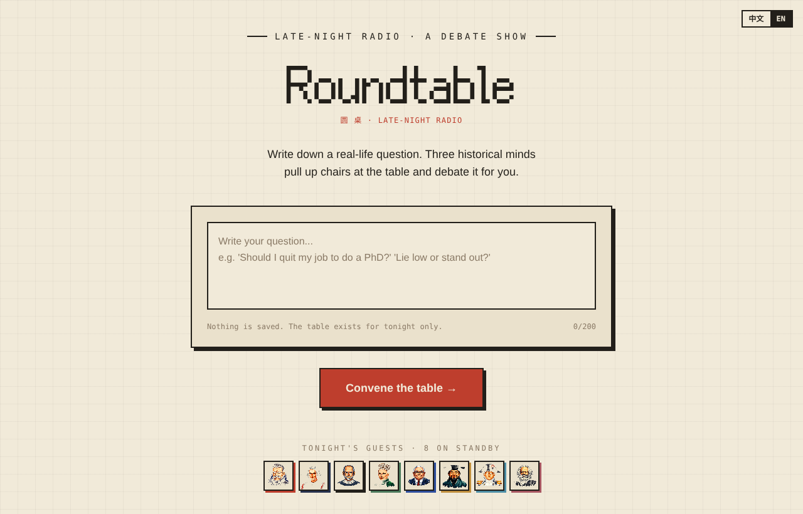
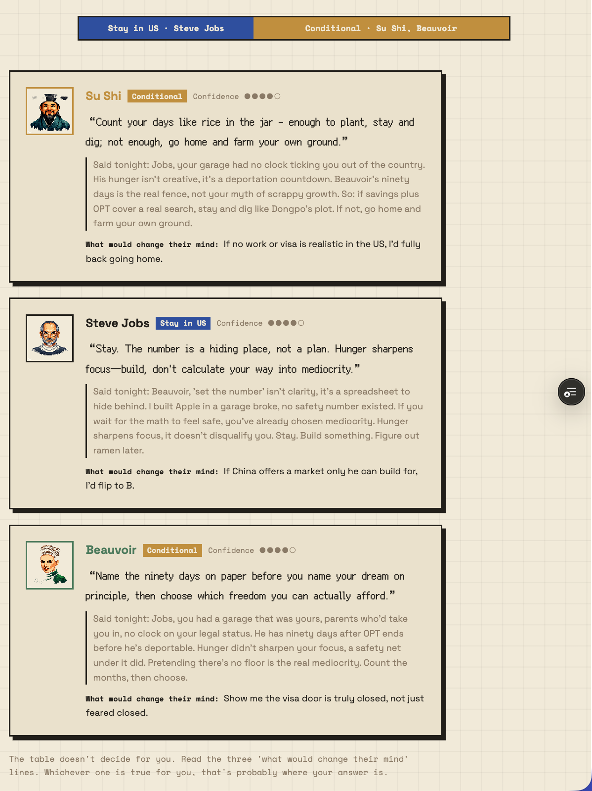
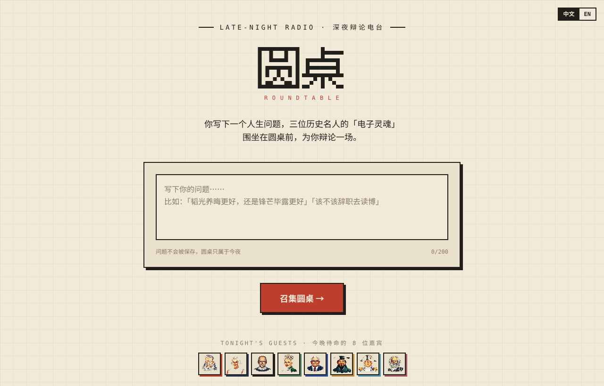

# Roundtable · 圆桌

**English** · [中文](#中文)

> Write down a real-life question. Three historical minds pull up chairs and debate it for you, until there's a verdict.

**Live:** https://roundtable-debate-blue.vercel.app (add `?lang=en` for English, `?lang=zh` for Chinese)



---

## What it is

Roundtable is a multi-agent debate app. You bring a decision you're stuck on ("Should I quit my job for a PhD?"). It is framed into an either/or motion, you pick 3 of 8 historical figures (Nietzsche, Machiavelli, Steve Jobs, Simone de Beauvoir, Charlie Munger, Su Shi, Napoleon, Karl Marx), and they argue it out loud. You can cut in at any point. It ends with a **verdict card**: who landed where, the line they said that shows it, and what would change each of their minds.

The whole product runs in Chinese and English.



<sub>A real run: "Should you stay in the US job hunting or return to China?" Each guest's final side, the advice, the line from the debate that backs it, and what would change their mind.</sub>

## The product problem I worked on

The first version produced *three parallel opinions*, not a debate. Each figure answered the question in their own voice, the conversation drifted away from the user's question, and it stopped after a fixed number of rounds whether or not anything had been settled. Reading the code showed why:

| Symptom | Root cause |
|---|---|
| Three monologues | The question went into the prompt as-is; nothing gave the guests a shared thing to take sides on. The rules even allowed "advance your own point without engaging anyone". |
| No sense of progress | The system didn't know who stood where, so it couldn't tell whether anyone had been persuaded. |
| Arbitrary ending | `round >= 4` → "time to wrap up". |
| Ending unrelated to the question | Closing advice was picked by a length/punctuation heuristic. |
| Hard to follow | Text typed at ~22 chars/s with ≤3.6 s pauses, 2–3× faster than people read. |

What I changed (v3):

1. **Frame a motion first.** The question becomes an editable card: one question plus side A vs side B. It states the disagreement; it never assigns anyone a side.
2. **Self-reported stances.** Every turn returns `stance` (A / B / conditional) and `confidence` (1–5). Openings also state *what would change my mind*. The UI shows live stance chips and a "X switched sides" event, which is where a debate feels alive.
3. **Engagement rules.** After the opening, every turn must answer a specific line from someone on the other side (or the user). Changing sides is allowed, but the guest must say whose line moved them.
4. **A content-based ending standard,** rule-based and unit-tested (`api/_ending.js`):
   - **Consensus**: all three on one side; nudge one speaker once ("if you actually disagree, say so now"); still unanimous → consensus.
   - **Settled disagreement**: no side changes for 2 rounds *and* every opposing pair has directly clashed.
   - **Going in circles**: no change for 3 rounds while some opposing pair never engaged.
   - Plus a **5-minute show clock** that counts only playback time (not model latency, not pauses), and a 10-round hard cap.

   All of these only *suggest* ending; the user decides.
5. **Reading-speed pacing.** Typing slowed to reading speed, with pause, "next speaker" (space bar) and prefetching of the next round while you read, so latency is hidden.
6. **Verdict card instead of generic advice.** Tally, final sides, the source quote, and the change-my-mind conditions. All of it comes from structured fields, with no extra "summarize the debate" model call.

## Design principles

1. **Personality is the position.** No prompt ever says "you argue the con side". Positions emerge from each character card.
2. **Rules protect personality; they never produce content.** The ending detector and word limits stop characters from collapsing, but never speak for them.
3. **The user is the host.** They can cut in, end, or keep going at any time; nothing is forced.

## How it works

```
Landing ─▶ Motion (frame) ─▶ Casting (3 of 8) ─▶ Debate rounds ─▶ Verdict
              │                                     │
        POST /api/debate                   POST /api/debate  (one request per round,
        phase: frame                       phase: debate      stateless backend;
                                                              client sends full history)
                                                    │
                                          _ending.js decides: consensus / settled /
                                          looping / keep going
```

- **Design:** the UI and first frontend version were designed and generated with **Kimi Design**, then iterated in code. The v3 screens (motion card, stance tags, verdict card) were built by hand in the same visual language.
- **Frontend:** React 19 + Vite + TypeScript + Tailwind (shadcn/ui); share card exported with html2canvas.
- **Backend:** one Vercel Function, `POST /api/debate`, stateless. The client sends the history, private memory and motion on every request.
- **Model:** Claude via the Anthropic Messages API, structured JSON output with defensive parsing (retries on empty or truncated output).
- **Character cards are the product.** `characters/*.json` (Chinese) and `characters/en/*.json` (English) share one schema: creed, bio, voice, taboos, arsenal (arguments + anchors), relations to the other seven, example dialogues. English cards are rewritten for English voice, not translated line by line.
- **Bilingual by design.** `src/lib/i18n.tsx` (the type system forces the English dictionary to cover every key) and `api/_prompts.js` (two prompt sets, one JSON contract).
- **No accounts, no database.** A debate is a session; refresh and it's gone.

## Run it

```bash
npm install
npm run dev                 # frontend only

# Full flow without an API key (mock model):
npm run build && npm run preview:mock     # http://localhost:4173

# Ending-rule + parsing + bilingual tests (mock model, no key needed):
npm run test:ending
```

For real debates, set `CLAUDE_API_KEY` in your Vercel project's environment variables (Production and Preview).

## Limitations and next steps

- Stances are self-reported by the model. The ending rules are only as honest as those reports; a separate judge was deliberately not added (principle 2), which is a trade-off.
- Character "likeness" is evaluated by reading transcripts, not by a systematic eval yet. That's the next thing to build.
- Content is generated about real historical figures; lines are characterizations, not quotations, except where marked as anchors.

---

## 中文

> 写下一个人生问题，三位历史名人的「电子灵魂」围坐圆桌为你辩论一场，直到给出裁决。

**线上地址：** https://roundtable-debate-blue.vercel.app（加 `?lang=zh` / `?lang=en` 直接切换语言）



真实一场的裁决页（英文版）见上方英文部分的截图。

### 这是什么

一个多智能体辩论产品。你带着一个拿不定主意的问题来（比如"该不该辞职去读博"），系统先把它立成二选一的辩题，你从 8 位历史人物（尼采、马基雅维利、乔布斯、波伏娃、芒格、苏轼、拿破仑、马克思）里选 3 位，他们当面辩论，你随时可以插话。最后生成一张**裁决卡**：谁站哪边、凭哪句本场原话、什么能让他改主意。中英双语。

### 我解决的产品问题

第一版的实际体验是"三份平行意见"，不像辩论：用户问完问题，三个人各说各的，讨论离问题越来越远，到第 4 轮就固定结束，不管有没有辩出结果。读代码找到的原因和改法：

| 现象 | 根因 | 改法 |
|---|---|---|
| 各说各的 | 问题原样进 prompt，没有可站队的命题；规则允许"不引用任何人" | 先**立题**（辩题 + A/B），交锋轮必须针对立场不同者的一句具体的话 |
| 看不出进展 | 系统不知道谁站哪边 | 每条发言自报**立场 + 信心**，界面实时显示，有人改立场单独播报 |
| 结束随意 | `round >= 4` 就收尾 | **按内容结束**：共识 / 分歧已清楚 / 绕圈（规则判定、有单测），加 5 分钟节目时长（只计播放时间）和 10 轮硬上限，都只建议、由用户拍板 |
| 结尾和问题脱节 | 忠告按字数和标点挑句子 | **裁决卡**：计票、最终立场、出处原话、改主意条件，全部来自结构化字段，不新增总结调用 |
| 读不过来 | 打字速度是阅读速度的 2–3 倍 | 按阅读速度播放，可暂停、跳下一位，边读边预取下一轮 |

### 三条设计原则

1. **人格即立场**：从不告诉角色"你是反方"，立场从人物卡里自然长出来。
2. **规则只保护人格，不产生内容**：结束判定、字数限制只防止人格崩坏，不替角色说话。
3. **用户是主持人**：随时插话、随时喊停、也可以继续聊，不被强制。

### 技术要点

- 界面设计与前端初版用 **Kimi Design** 设计生成，之后在代码里迭代；v3 新增的立题页、立场标签、裁决卡沿用同一套视觉语言手写扩展。
- 前端 React 19 + Vite + TypeScript + Tailwind（shadcn/ui）；后端单个 Vercel Function，无状态，前端每轮带完整上下文请求。
- 模型：Claude（Anthropic Messages API），结构化 JSON 输出 + 容错解析（空输出、截断都会重试或兜底）。
- 人物卡即产品：中文 `characters/*.json`、英文 `characters/en/*.json`，同一套字段；英文卡按英文语感重写，不是逐句翻译。
- 双语：`src/lib/i18n.tsx`（英文字典由类型强制覆盖全部 key）+ `api/_prompts.js`（两套提示词，同一个 JSON 契约）。
- 无账号、无数据库，一场辩论即一个 session。

### 本地运行

```bash
npm install
npm run build && npm run preview:mock   # 不需要 API key，用假模型跑通全流程
npm run test:ending                     # 结束标准 / 解析容错 / 双语测试
```

真实辩论需要在 Vercel 环境变量里配置 `CLAUDE_API_KEY`（Production 和 Preview 都要勾上）。

### 局限与下一步

- 立场由模型自报，结束判定的可信度取决于自报是否诚实；刻意没有加一个额外的"裁判模型"（违反原则 2），这是一个取舍。
- 角色"像不像本人"目前靠人工读对话判断，还没有系统化评测，这是下一步。
- 内容涉及真实历史人物，台词是基于其思想的演绎，不是原话（标为"锚点"的除外）。

更多产品与工程约定见 [AGENTS.md](AGENTS.md)，迭代记录见 [CHANGELOG.md](CHANGELOG.md)。
